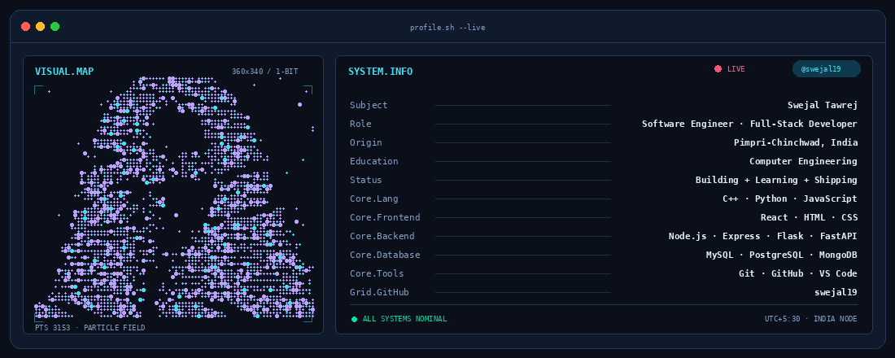

  

 
 
  

  
  
  

---

## 👋 Hey there, I'm Swejal!

I'm a **Computer Engineering student and aspiring Software Engineer** who enjoys turning ideas into practical applications. I work across web development and AI/ML, and I love building projects that combine clean interfaces, useful features, and intelligent technology.

- 💻 Interested in **Software Engineering, Full-Stack Development, and AI/ML**.
- 🧠 Practising **C++ and data structures & algorithms** as part of my software engineering journey.
- 🌐 Building with **JavaScript, React, Node.js, Python, Flask, and FastAPI**.
- 🤖 Exploring machine learning and AI-powered applications.
- 🎨 Outside code, I enjoy sketching and painting.
- 🚀 My current goal: keep learning, build meaningful projects, and grow as a software engineer.

> **I believe the best way to learn technology is to build with it.**

---

## 🧰 My Tech Stack

### Languages

### Frontend

### Backend & APIs

### Databases & Tools

### AI / ML

---

## 🚀 Featured Projects

<!-- Replace each YOUR_GITHUB_USERNAME/project-repository link with the actual repository URL. -->

<table>
  <tr>
    <td width="50%" valign="top">
      <h3>🎵 VibeTrack — Emotion-Aware Music Recommender</h3>
      
A music recommendation project that uses facial-expression emotion recognition to suggest music based on a user's detected mood.

      
<strong>Tech:</strong> Python, TensorFlow/Keras, OpenCV, Flask, React, MySQL

      
<a href="https://github.com/YOUR_GITHUB_USERNAME/VibeTrack">View repository →</a>

    </td>
    <td width="50%" valign="top">
      <h3>🗂️ Stratify — Goal Setting & Tracking Portal</h3>
      
A full-stack goal management portal with role-based dashboards, progress tracking, and analytics to help users stay focused on their goals.

      
<strong>Tech:</strong> React, Supabase, PostgreSQL, Recharts

      
<a href="https://github.com/YOUR_GITHUB_USERNAME/Stratify">View repository →</a>

    </td>
  </tr>
  <tr>
    <td width="50%" valign="top">
      <h3>💉 VaxTrack — Vaccine Tracking System</h3>
      
A database-driven system concept for managing vaccine information and tracking vaccination records.

      
<strong>Tech:</strong> Java, Spring Boot, MySQL, React

      
<a href="https://github.com/YOUR_GITHUB_USERNAME/VaxTrack">View repository →</a>

    </td>
    <td width="50%" valign="top">
      <h3>📸 PhotoBooth Web App</h3>
      
A browser-based photobooth for capturing a photo strip, applying visual filters, previewing backgrounds, and downloading the result.

      
<strong>Tech:</strong> HTML, CSS, JavaScript, Canvas API

      
<a href="https://github.com/YOUR_GITHUB_USERNAME/PhotoBooth">View repository →</a>

    </td>
  </tr>
</table>

<i>More projects and experiments are available across my repositories.</i>

---

## 📊 GitHub at a Glance

  
  
   
  

---

## 🌱 What I'm Working On

- Strengthening **DSA, problem-solving, and core computer science fundamentals**.
- Improving my full-stack development skills by building and refining real projects.
- Learning more about **machine learning and AI-powered software**.
- Writing cleaner code, documenting projects, and collaborating through Git and GitHub.

---

## 🤝 Let's Connect

I'm always happy to connect with fellow developers, learn from others, and discuss software projects, web development, or AI/ML.

**Build with curiosity. Improve with consistency. Ship with purpose.** ✨

<a href="https://github.com/YOUR_GITHUB_USERNAME">Explore my repositories</a>

